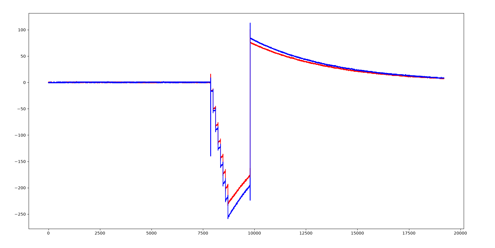
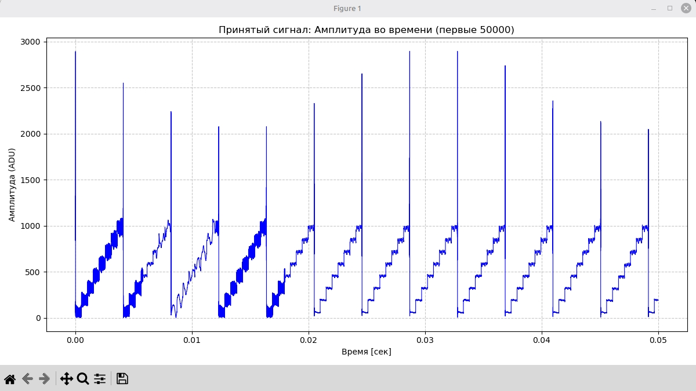
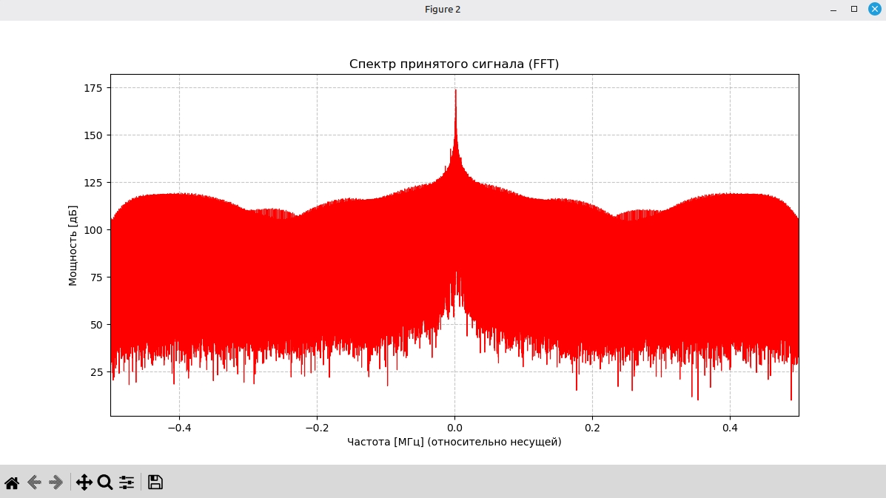
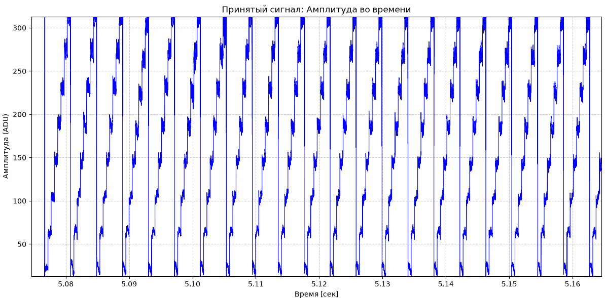
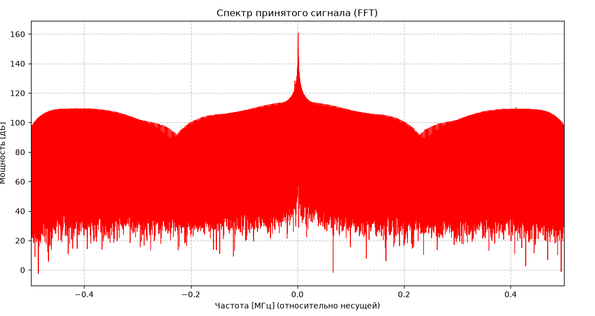
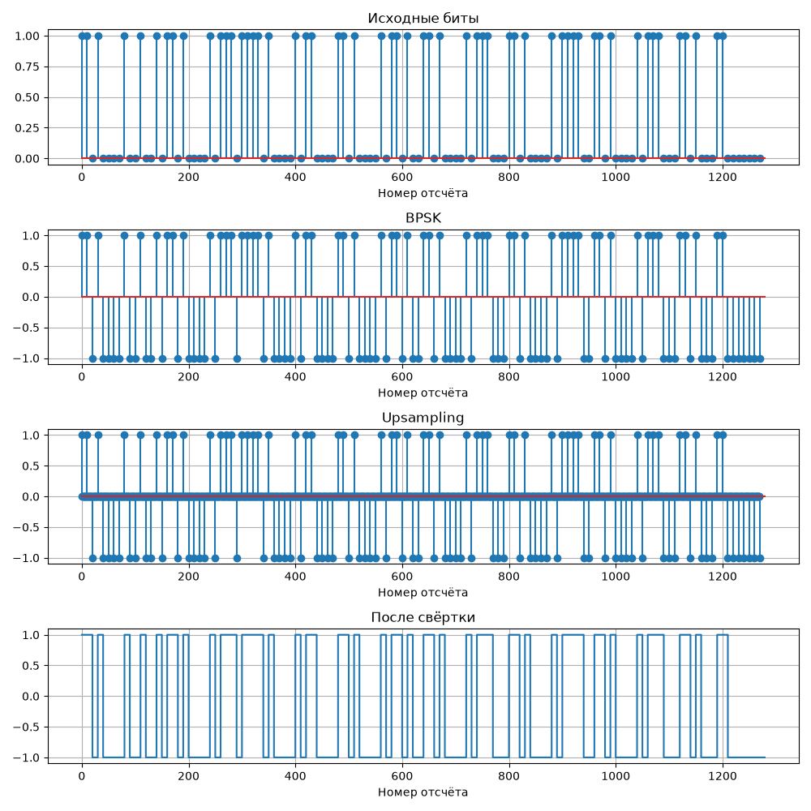

# SDR
## Структура файлов с картинками для отчетов

| Папка | Описание |
|-------|----------|
| **weekThree** | Инициализация и запуск первоначального кода для SDR |
| **weekFour** | Оставлен только **TX** — передача сигнала одногруппнику |
| **weekFive** | Передача аргумента в код: выбор режима **TX** или **RX** |
| **weekSix** | Тестовая реализация модуляции BPSK и свёртки |

### Неделя 1 — Установка и настройка
- Установка необходимых библиотек
- Настройка GNU Radio

### Неделя 2 — Первые эксперименты
- Ловили радиоэфир
- Проверяли, возможно ли увидеть передачу по Wi-Fi

### Неделя 3 — Запуск SDR
- Инициализация SDR
- Запуск первоначального кода

Реальная и мнимая часть:

### Неделя 4 — Только передача (TX)
- Оставлен только режим TX
- Использовался для передачи сигнала одногруппнику

Реальная часть полученного сигнала у одногрупника:

Спектр полученного сигнала у одногрупника:

### Неделя 5 — Гибкий режим TX/RX
- Передача аргумента в код
- Выбор режима работы: TX или RX

Реальная часть полученного сигнала:

Спектр полученного сигнала:

### Неделя 6 — BPSK и свёртка
- Генерация случайных битов
- Модуляция BPSK
- Upsampling — вставка нулей между символами
- Свёртка с прямоугольным фильтром для формирования импульсов

График свертки и модуляции:

